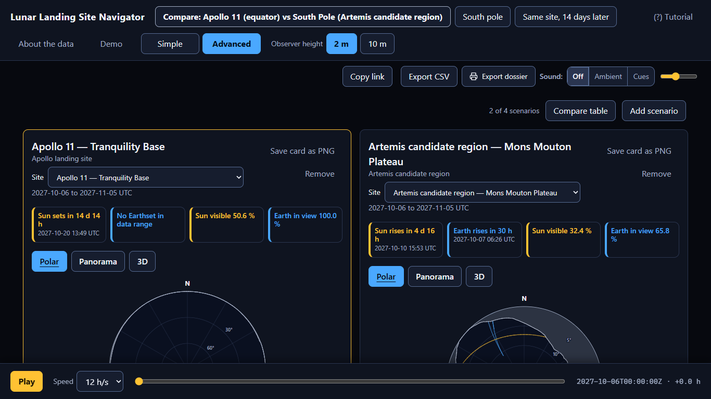
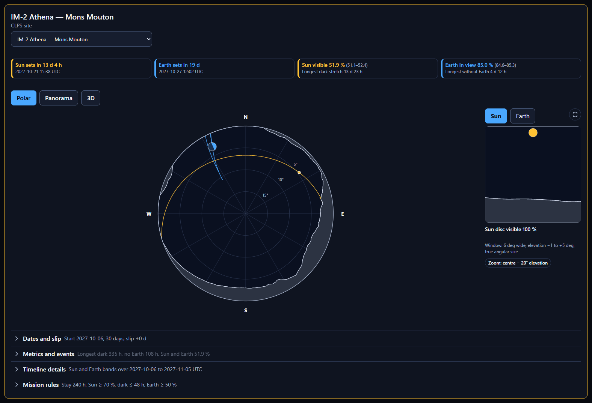
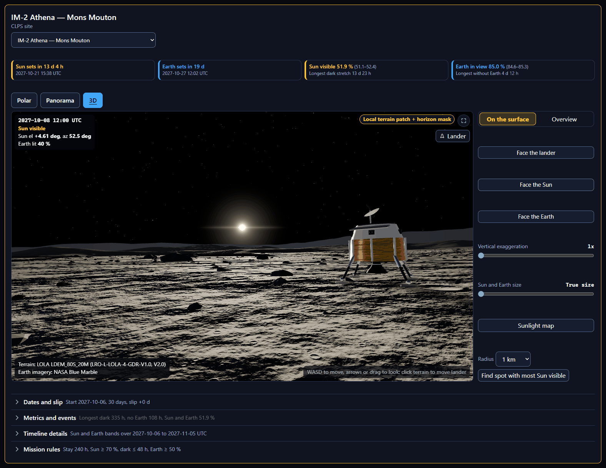
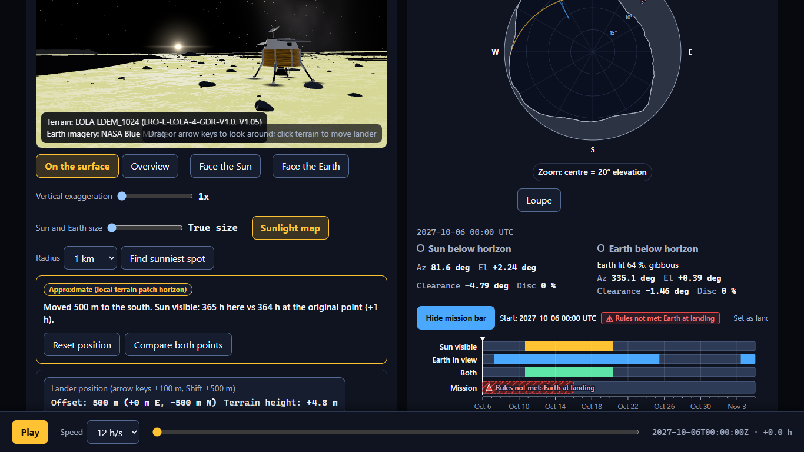
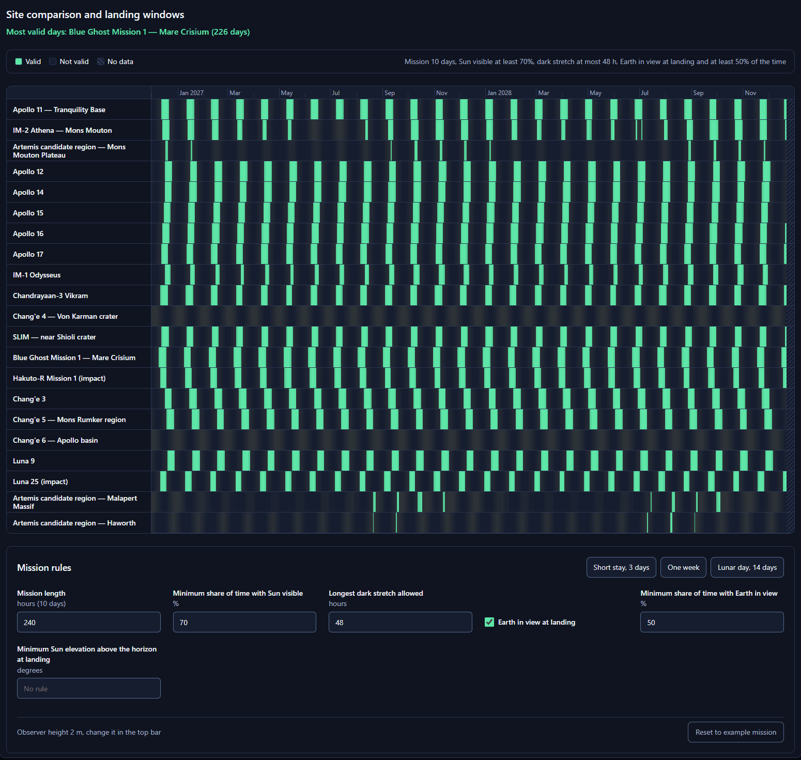
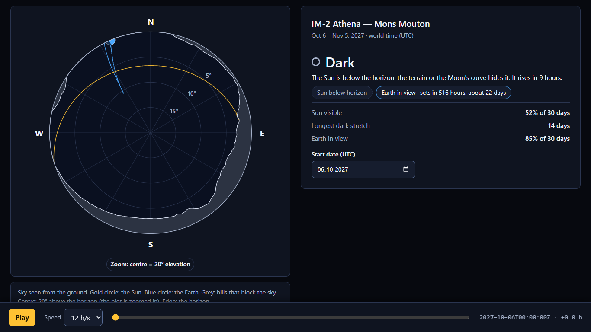

# Lunar Landing Site Navigator

Lunar Landing Site Navigator is a browser tool for comparing lunar landing sites and dates side by side. It shows where the Sun and the Earth sit relative to the local terrain horizon, so mission planners, educators and the public can judge sunlight and Earth visibility for a candidate window.

NASA Space Apps Challenge 2026, Rzeszów local event.

## Screenshots













## Features

### Compare
- Up to four scenario cards (site and date per card) in the scenario board, with a compare table.
- Presets, in the menu of the Add scenario button: *Apollo 11 vs South Pole*, *South pole*, and *Same site, 14 days later*.
- Metrics per card: Sun visible, longest dark stretch, Earth in view, and countdowns to the next Sun and Earth events. Every metric has a tooltip with its definition.
- Observer height switch (2 m or 10 m) with the extra Sun hours of a 10 m mast shown against 2 m.

### Time
- Play and pause with speeds of 1, 6, 12, 24, 72 and 168 hours per second.
- Time cursor and scrubber; scenarios with different dates play in step on a relative timeline.
- Mission slip of up to ±60 days per scenario.
- All times are UTC, shown in ISO 8601 with a trailing `Z`.

### Sky
- Polar sky plot of the local terrain horizon with the Sun and Earth paths.
- Panorama view of the same paths against the horizon.
- Loupe showing the visible fraction of the solar disc while a ridge clips it.
- Elevation chart with Sun and Earth clearance over time.
- Status labels: *Sun visible*, *Sun below horizon*, *Earth in view*, *Earth below horizon*.

### 3D
- Terrain view loaded on demand (`React.lazy`), so the first screen does not load three.js.
- Shadows updated from the Sun position at the time cursor.
- Two camera modes: On the surface and Overview; quick views and tracking lock toward the lander, Sun or Earth.
- Movable lander (arrow keys, Shift for larger steps) with the local horizon recalculated.
- "Sun visible map" over the patch and "Find spot with most Sun visible" search with a radius of 500 m, 1 km or 2 km, run in a Web Worker.
- Earth disc textured with NASA Blue Marble imagery, placed from the ephemeris and oriented from `earth_orientation.json` when it is present (otherwise the orientation is labelled illustrative).

### Planning
- Mission rules: mission length, minimum Sun share, maximum dark stretch, Earth in view at landing and Earth share. Presets for 72 h, 168 h and 336 h stays; the reset button restores the 240 h example.
- Mission bar on the timeline: green when the candidate landing meets all rules, red with the failing rule named when it does not.
- Window finder: a site-by-date matrix of landing windows, computed in a Web Worker.
- Moon map: orthographic view of the Moon with site markers, the subsolar point and the day/night terminator.
- Site library with status, coordinates and provenance.
- Custom site coordinates (latitude and longitude). See Data below for how these are labelled.

### Sharing and export
- Share link: the workspace state (scenarios, dates, slip, observer height, view) is kept in the URL.
- CSV export of the hourly time series (UTC time, Sun and Earth azimuth and elevation, visibility).
- Dossier export for printing.
- "Record video" in the demo narration, which saves a WebM file of the browser tab.

### Accessibility
- Keyboard operation for all controls; visible focus outlines; controls have accessible names.
- Colour is never the only carrier of status: text labels and shapes are used as well.
- `prefers-reduced-motion` is respected; demo mode and playback start only on a user action.
- Opening: a plain link starts in Simple mode; use `?m=a` (or the mode switch) for Advanced, which the presets need.
- Simple mode: switchable Polar, Panorama and 3D views with plain-language summaries for teaching and public demonstrations.
- Guided tour (`Tutorial` button) and a demo narration (`Demo` button).

### Sound
- Off by default. A compact Off / Ambient / Cues control in the tools bar; a volume slider slides in when sound is on.
- Web Audio synthesis only; no audio files are loaded.

## Quick Start

Requirements: Node.js 20.19 or newer (CI uses 24) and npm.

```bash
cd web
npm ci            # install exact dependencies
npm run dev       # local dev server, http://localhost:5173
```

Other scripts, run from `web/`:

```bash
npm run typecheck  # TypeScript check
npm test           # Vitest unit tests
npm run build      # production build into web/dist
npm run preview    # serve the production build locally
npm run lint       # Oxlint
npm run gen:mocks  # regenerate the synthetic mock datasets
```

## Data

- **Contract**: data files follow [docs/contract.md](docs/contract.md) (contract version 1.1.1). Times are UTC, angles in degrees, longitude east-positive, azimuth measured from north clockwise.
- **Real and mock data**: the app reads real datasets from `web/public/data/` (`sites.json`, `ephem/`, `horizon/`, `terrain/`, `earth_orientation.json`). The loader (`web/src/lib/loader.ts`) falls back to synthetic datasets in `web/public/data/mock/` for each site whose real files are missing, and `VITE_USE_MOCK=1` forces mock data everywhere.
- **Labels**:
  - Synthetic data is marked with a `Synthetic data` badge.
  - Approximate values, including custom coordinates computed without the optional service, carry an `Approximate` badge.
  - Derived values (Earth phase, solar limb clipping, local terrain horizon) are labelled as derived.
- **Heatmap**: the 3D sunlight heatmap is computed in the browser from the local terrain. The pipeline's `illum/` files (21 by 21 cells, approximate) are used for validation against NASA PGDA, not rendered by the app.
- **Sources**: each real site lists its source URL in `sites.json`; the pipeline records its inputs in each file's `meta`.

## Environment Variables

Set them in `web/.env` or in the build environment. A template is in [web/.env.example](web/.env.example).

| Variable | Default | Description |
|---|---|---|
| `VITE_BASE` | `/` | Base path for assets. Use `/<repository-name>/` for GitHub Pages. |
| `VITE_USE_MOCK` | `0` | Set to `1` to use synthetic mock data for every site. |
| `VITE_API_URL` | unset | Optional custom-site service. Its origin is added to the CSP `connect-src` at build time. If it is unreachable, the app uses the client-side approximation. |

## Deployment

### GitHub Pages
The workflow [.github/workflows/deploy-web.yml](.github/workflows/deploy-web.yml) runs on pushes to `main` that touch `web/**` or the workflow file. It runs `npm ci`, `npm run typecheck`, `npm test` and `npm run build` with `VITE_BASE=/<repository-name>/`, then deploys `web/dist`. In the repository settings, Pages must be set to **GitHub Actions**. GitHub Pages on a private repository needs a plan that supports it.

### Vercel (alternative)
- Framework preset: Vite
- Root directory: `web`
- Build command: `npm run build`
- Output directory: `dist`
- Environment: `VITE_BASE=/` (default)

## Project Structure

```
├── README.md                 # This file
├── CLAUDE.md                 # Shared project instructions
├── CRITICAL.md               # Cross-scope notices
├── pipeline/                 # Data pipeline (Python, scope A)
├── validation/               # Validation scripts, results and metric fixtures
├── .github/workflows/
│   └── deploy-web.yml        # Deployment workflow
├── docs/
│   ├── contract.md           # Data contract between the data and web scopes
│   ├── demo-script.md        # Live demo script and 30-second video storyboard
│   ├── pitch.md              # Pitch numbers and sources (scope A)
│   ├── method.md             # Method notes
│   ├── sources.md            # Source list with per-value URLs
│   ├── scope-A-data.md       # Data and science scope brief
│   ├── scope-B-web.md        # Web app scope brief
│   ├── status-B.md           # Web app status notes
│   └── status-A.md           # Data scope status notes
└── web/
    ├── public/
    │   ├── data/             # Real datasets (sites, ephemerides, horizons, terrain)
    │   │   └── mock/         # Synthetic mock datasets
    │   ├── brand/            # Logo, icons and brand notes
    │   └── textures/earth/   # Earth textures and credits
    ├── scripts/gen-mocks.mjs # Mock data generator
    ├── src/
    │   ├── app/              # App shell, top bar, panels, tools
    │   ├── components/       # Feature components (sky, scenario, finder, map, demo, help, sound, ...)
    │   ├── config/           # Presets and data ranges
    │   ├── lib/              # Pure logic: horizon, ephemeris, metrics, finder, loader, export
    │   ├── state/            # Store, selectors, URL sync
    │   └── viz3d/            # 3D surface view, heatmap, sunniest-spot search
    ├── package.json
    └── vite.config.ts
```

## Credits and Licences

### Earth imagery
- **NASA Blue Marble** textures (`land_ocean_ice_1024.jpg`, `cloud_combined_1024.jpg`) in `web/public/textures/earth/`.
- Credit: NASA Goddard Space Flight Center. Land surface, shallow water and cloud images by Reto Stockli; ocean colour, compositing and enhancements by Robert Simmon.
- Source: [NASA Earth Observatory, Blue Marble](https://science.nasa.gov/earth/earth-observatory/the-blue-marble-true-color-global-imagery-at-1km-resolution). Full notice: [web/public/textures/earth/CREDITS.txt](web/public/textures/earth/CREDITS.txt).

### Typography and logo
- The interface uses the system font stack; no font files are loaded at runtime.
- The logo wordmark is derived from the [Inter](https://github.com/rsms/inter) typeface by Rasmus Andersson and contributors, licensed under the SIL Open Font License 1.1. See [web/public/brand/FONT-LICENSE.txt](web/public/brand/FONT-LICENSE.txt) and [web/public/brand/README.md](web/public/brand/README.md).

### Open source libraries
Listed in [web/package.json](web/package.json):
- React and React DOM (MIT)
- Three.js (MIT)
- D3 (ISC)
- Zustand (MIT)
- Vite and Vitest (MIT)
- TypeScript (Apache 2.0)
- Oxlint (MIT)

## Limitations

- **Approximate custom sites**: custom coordinates use the optional custom-site service when it is reachable. Otherwise they use a client-side approximation that rotates the nearest loaded site's ephemeris, labelled `Approximate`.
- **Local terrain only in 3D**: the 3D view shows a local terrain patch and the shadows within it. It does not do Moon-wide ray tracing.
- **Not a flight-planning tool**: the app gives geometric line-of-sight results. It does not compute transfer trajectories, descent burns, landing hazards or surface trafficability.
- **No power or link guarantees**: the app reports *Sun visible*, *Sun below horizon*, *Earth in view* and *Earth below horizon*. It says nothing about solar array output, thermal survival, battery state or radio link margin.

## How This Was Built

The project was built for the NASA Space Apps Challenge 2026 (Rzeszów local event) by two people with a split of scope: the data scope covered elevation models, ephemerides and validation, and the web scope covered the interactive app and visualisation. Development was AI-assisted, with coding agents used for well-specified functions, tests and boilerplate, and the human leads reviewing the integration. Preparation was done locally before the official start; work in this repository began at 09:03 on 2026-11-14.
